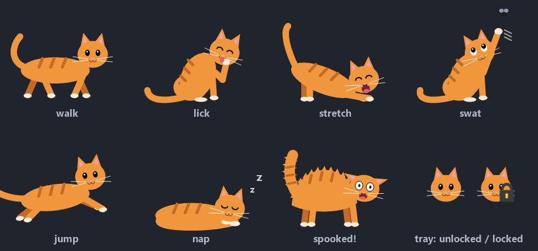

# 🐱 CatLock

**Lock your keyboard, mouse and touchpad with one key combo, so your cat can walk across your laptop without typing anything.**

Press **Ctrl+Esc** to lock. Press **Ctrl+Esc** again to unlock. While it's locked, a little orange tabby wanders around your screen.



## Features

- **One combo to lock and unlock.** Ctrl+Esc does both.
- **Blocks everything.** Keyboard, mouse, touchpad taps and scrolling are all blocked, even input that touchpad drivers send straight to windows.
- **An animated cat while locked.** It walks back and forth across the screen, and every 10–25 seconds it stops at random to:
  - lick its paw
  - stretch and yawn
  - sit up and swat at a fly buzzing overhead
  - jump up to a higher spot on the screen
  - curl up for a 30-second nap, with floating Zzz
  - get spooked, now and then: it jumps, puffs up, hisses and runs off
- **Tray icon.** A cat face in the system tray, with a padlock badge while locked. Right-click it for **Lock now** or **Exit**.
- **Tiny and self-contained.** One small `.exe`. No installer, no dependencies, no internet access, no settings files.

## Download and run

1. Grab `CatLock.exe` from the [Releases](../../releases) page.
2. Double-click it. A cat icon appears in the system tray, by the clock.
3. Press **Ctrl+Esc** to lock and **Ctrl+Esc** again to unlock.

Requires Windows 10 or 11. Nothing to install, because it uses .NET Framework 4, which comes with Windows.

### "Windows protected your PC"?

CatLock isn't code-signed, so SmartScreen may warn you the first time you run it. Click **More info → Run anyway**. Some antivirus tools are also suspicious of any app that hooks the keyboard, since keyloggers do the same. If you'd rather not trust a downloaded exe, [build it yourself](#build-it-yourself) from the source. It's short and easy to read.

### Start it automatically

Press **Win+R**, type `shell:startup`, and put a shortcut to `CatLock.exe` in the folder that opens.

## Safety: you can't get stuck

- **Ctrl+Alt+Del always works.** Windows doesn't let apps block it. If anything goes wrong, open Task Manager and end **CatLock**. Input comes back the moment it closes.
- When you unlock, Ctrl, Alt, Shift and Win are released properly, so none of them stays "stuck" down.
- Only one copy of CatLock can run at a time.

**Note:** Some touchpad gestures, like three- or four-finger swipes for Task View or switching desktops, are handled by Windows itself and may still work while locked.

## Build it yourself

You don't need Visual Studio or any SDK. `build.cmd` uses the C# compiler that ships with Windows.

```bat
git clone <this repo>
cd CatLock
build.cmd
```

This produces `CatLock.exe`. The first build also generates `cat.ico`, the exe's icon. Delete that file to regenerate it if you change how the cat looks.

> Close CatLock before rebuilding. The compiler can't overwrite the exe while it's running.

## Tweaking the cat

All the timings are constants at the top of [`CatWalker.cs`](CatWalker.cs). The animation runs at about 30 frames per second, so **30 frames = 1 second**.

| Setting | What it controls | Default |
|---|---|---|
| `Speed` | Walking speed (pixels per frame) | `4` |
| `WalkMinFrames` / `WalkMaxFrames` | Time spent walking between activities | 10–25 s |
| `LickMinFrames` / `LickMaxFrames` | Licking time | 4–7 s |
| `StretchMinFrames` / `StretchMaxFrames` | Stretching time | 3–5 s |
| `SwatMinFrames` / `SwatMaxFrames` | Swatting time | 3–6 s |
| `NapMinFrames` / `NapMaxFrames` | Nap length | 25–35 s |
| `JumpMinRise` / `JumpMaxRise` | How much higher it lands after a jump (pixels) | 120–320 |
| `ScaredOdds` | 1 in *N* breaks is a fright instead | `12` |

To change the lock combo, edit `ComboKey` and `ComboText` at the top of [`CatLock.cs`](CatLock.cs). Ctrl is always part of the combo.

## How it works

- **Blocking input:** low-level keyboard and mouse hooks (`WH_KEYBOARD_LL` / `WH_MOUSE_LL`) swallow every event while locked. The one exception is the unlock combo. The hooks run on their own high-priority thread, so the animation can never delay them. That matters because Windows lets input through if a hook is too slow to answer.
- **The shield:** while locked, a practically invisible window covers every monitor and takes focus. Some touchpad drivers (Alps, Synaptics, Elan) send scroll and gesture messages directly to the window under the cursor, skipping the hooks. With the shield on top, those land on it and are ignored.
- **The cat:** drawn in code with GDI+ (no image files) into a click-through, per-pixel-alpha layered window, and moved around the screen each frame.

## Files

| File | Purpose |
|---|---|
| `CatLock.cs` | Tray icon, lock/unlock, input hooks, shield and "Locked" banner |
| `CatWalker.cs` | The cat: behavior and all the drawing |
| `MakeIcon.cs` | Generates `cat.ico` for the exe (run by `build.cmd`) |
| `build.cmd` | Builds everything with the built-in C# compiler |

## License

[MIT](LICENSE). Free to use, modify and share.
